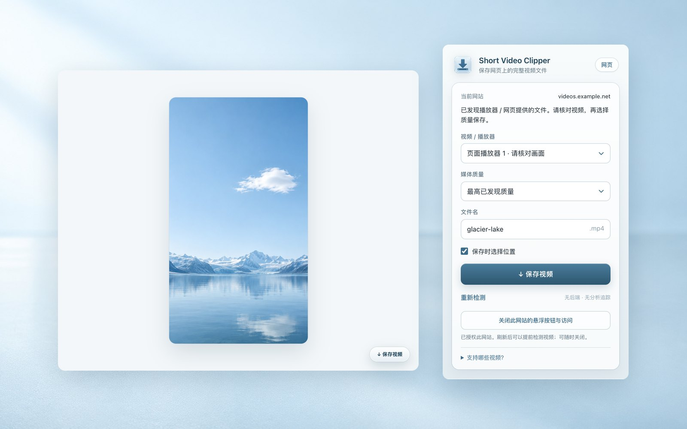
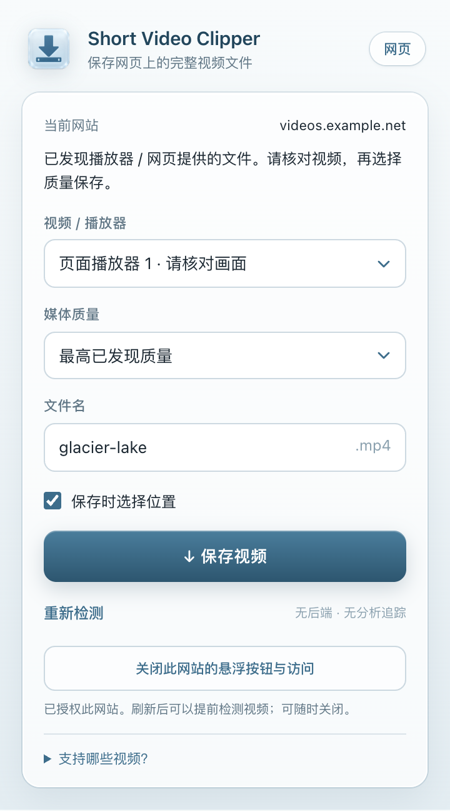
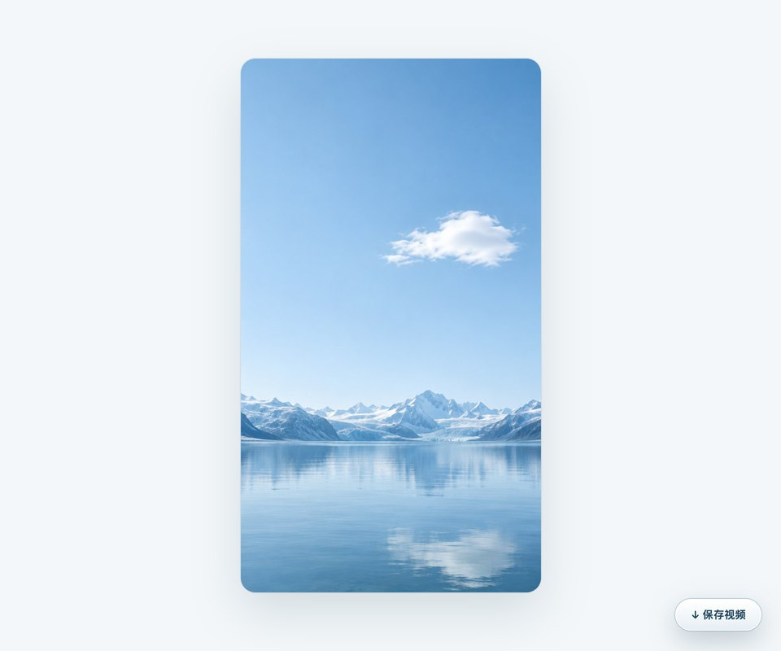

# Short Video Clipper



一个无后端、无运行时依赖的 Chrome Manifest V3 视频保存扩展。冷色玻璃风格的 popup、清楚的质量与文件名选择，以及按站点启用的「↓ 保存视频」悬浮按钮，参考 Web Clipper 的轻量体验，不使用 Obsidian 的品牌或资源。

**0.4.0 支持在 LinkedIn、X 信息流中检测当前画面的视频，保留单帖、Instagram、TikTok 和普通视频网页检测。无需为了检测而逐条打开帖子。** 只保存页面提供、且能识别为完整视频文件的 HTTP(S) 地址，不保证任意平台或视频都可下载。平台适配与验证范围见 [TEST-REPORT.md](TEST-REPORT.md)。

## 界面

| 工具栏 popup | 网页内悬浮按钮 |
| --- | --- |
|  |  |

截图来自本地加载的扩展与本地合成测试页（示例画面为生成图片），没有访问任何真实平台。

## 安装与更新（Chrome 111+）

### 已安装旧版

本机已安装扩展仍从原目录 `outputs/2026-10-12/x-video-clipper` 加载，以保留扩展身份；本次交付包位于 `outputs/2026-10-16`。将新版运行文件更新到原目录后，打开 `chrome://extensions`，找到 Short Video Clipper，点击「重新加载」，再刷新视频页面。请保留 Chrome 实际加载的源码目录。0.4.0 没有新增固定网站权限；LinkedIn 仍使用点击工具栏后的临时访问，常驻悬浮按钮需单独授权。

### 新安装

1. 解压 `short-video-clipper-install.zip`，得到 `short-video-clipper` 文件夹。
2. 打开 `chrome://extensions`，开启右上角「开发者模式」。
3. 点击「加载已解压的扩展程序」，选择含 `manifest.json` 的文件夹。
4. 在 Chrome 工具栏的扩展菜单中固定 Short Video Clipper。
5. 刷新已经打开的视频页面，再点击工具栏图标。

ZIP 供解压后本地加载，不能直接拖入 Chrome 安装；没有商店签名 CRX。受企业管理的 Chrome 可能禁止开发者模式。扩展运行与安装无需下载依赖。新包保留在 `2026-10-16` 日期目录，旧日期的 ZIP 和校验文件保留供回退。

## 使用

1. 浏览 LinkedIn、X 信息流或单条视频帖子，也可打开 Instagram、TikTok 或普通带有视频的网页。将想保存的视频滚动到当前画面并播放几秒。
2. 点击工具栏 Short Video Clipper。扩展检测当前顶层页面已经提供的媒体；LinkedIn、X 信息流只保留当前画面的候选。没有常驻网站授权时，需点击工具栏发起检测。
3. 选择「视频」与「媒体质量」，填写文件名，再点击「↓ 保存视频」。默认使用最高已发现质量，并弹出保存位置对话框。
4. 若希望以后在该站直接使用悬浮按钮，点击「为此网站启用悬浮按钮」并接受 Chrome 的该站点访问授权，然后刷新页面。扩展会随浏览在本地检测，发现完整视频后显示按钮。LinkedIn 页面若只有 blob / HLS 播放器且本地没有完整文件，仍需点击工具栏尝试公开帖子检测；后台不会随滚动自动读取公开帖子。
5. 再次打开 popup，可关闭该网站的悬浮按钮并撤销该站点访问授权。X 的两个原有域保留自动检测，界面显示「X 已启用自动检测」；此版不提供关闭 X 自动检测的单独开关。

Chrome 的内部页面、扩展页面、商店页等受保护页面不能注入脚本。本地 `file:` 页面不在此版支持范围内。页面内嵌的第三方播放器可能无法从顶层页面读取，需打开播放器所在网页后检测。

popup 打开时会自动检测，优先使用当前页面已发现的完整地址；点击「重新检测」会重新读取媒体信息，必要时重取公开帖子中的签名地址。重新检测不能保证失效签名恢复，原来选定的具体版本若消失会要求重新选择。滚动后请再打开或重新检测，确认 popup 对应当前画面。

### 视频、质量与文件名

- 发现多个视频时从 popup 选择；悬浮按钮提示打开 popup，避免擅自保存其中一个。LinkedIn、X 信息流候选随当前可见视频更新，离开画面的帖子不会混入保存选择。DOM 播放器候选可能是广告或预告，界面会提示核对画面。
- 可选「最高已发现」「最低已发现」或具体版本。分辨率、码率只来自页面字段或媒体 URL，不代表原片或服务器的完整质量列表。LinkedIn URL 中的高度标记会注明为推测，不能当作实测尺寸。最高/最低策略优先使用有可比较码率或尺寸线索的版本；完全未知的版本仍可手动选择。具体选择按该地址提交，不悄悄降级。
- 支持可识别的公共 HTTP(S) MP4、WebM、MOV、M4V、OGV 完整文件直链。媒体 URL 不接受账号密码、非默认端口、本机或常见私网地址；主机名筛选不能证明其 DNS 解析位置。无后缀地址仅在页面提供已知视频 MIME 等媒体线索时尝试识别；扩展不下载并检测字节来证明格式、完整性或音轨。
- 文件名去除路径、非法字符与 Windows 保留名称，限制长度，后缀随已选媒体格式变化。重名由 Chrome 自动加编号。
- 每个视频分别保留本次 popup 的文件名和具体质量选择；具体地址失效会提示重新选择，不自动改成最高质量。关闭 popup 后只保留已提交保存的位置开关与最高/最低质量策略；具体媒体 URL 和自定义文件名不持久保存，也不套用到另一条页面。
- 未开启「保存时选择位置」时进入 Chrome 默认下载目录；Chrome 自身设置仍可能弹出对话框。
- 「已提交给 Chrome」表示已发起下载。popup 显示最近一次状态；完成、暂停、恢复、取消请查看 `chrome://downloads`。关闭 popup 不影响已经提交的下载。

## 支持范围与实现

| 页面 | 如何寻找媒体 | 实际边界 |
| --- | --- | --- |
| LinkedIn 信息流与单帖 | 优先读取当前可见播放器公开的 `currentSources()`；另读归属明确的 `video[data-sources]`，必要时由 popup 检测读取可见帖子的公开 HTML | 只接收带媒体类型的 `licdn.com` 完整文件；无帖子 ID 的新版页面仍可使用播放器直链。离屏、邻帖和不同 activity 不混合；公开视图不保证可用 |
| X / Twitter 信息流与单条推文 | 观察页面原本发出的相关 JSON；单帖匹配当前推文 ID，信息流根据当前画面中 article 的时间链接核对推文归属 | 保留原来两个 X 域的自动检测；未观察到完整媒体、归属不明或不在当前画面时不列出；字段、协议或请求方式改变可能失效 |
| Instagram、TikTok 页面 | 顶层页面可用的 video/source 与已知嵌入 JSON；逐站授权后观察页面相关 JSON | 有帖子 / 视频 ID 时按身份过滤结构化数据；DOM 候选需核对，不保证每条帖子、Reel、下载版、无水印版或完整质量列表 |
| 普通 HTTP(S) 网页 | 顶层页面的 video/source，以及单页明确关联的 `og:video` / JSON-LD `VideoObject` 完整视频地址 | 不扫描任意嵌入 JSON 或全部网络地址；可能包含网页自身的广告或预告，需由用户选择 |

`observer.js` 在 MAIN world 观察 X、Instagram、TikTok 页面本来已经请求的相关 fetch/XHR JSON，不调用外部下载站或额外平台接口，不保存响应原文。平台 JSON 只按已知结构和当前页面媒体身份解析；Instagram/TikTok 网络候选还限制平台视频 CDN。一般网页依靠明确的媒体元素和标准页面元数据，不捕获所有请求中的可疑 URL。

LinkedIn 的 `linkedin-player.js` 在 MAIN world 读取当前可见 video 对应播放器公开的 `currentSources()`，最多检查 16 个可见播放器，只接收带类型的 `licdn.com` 完整 MP4 地址，包括 `video/mp4` 类型的无后缀地址。它不安装 fetch/XHR 钩子，不读取播放器私有全局变量、options 或账号信息。新版 LinkedIn 页面即使没有 activity ID，也可从可见播放器提供的完整文件检测。

`linkedin.js` 另解析归属明确的 `video[data-sources]`。没有完整地址且可见 video 能精确对应 activity 时，只有 popup 发起的检测才让后台读取该帖的公开 HTML：信息流最多处理屏幕内 5 帖，单次检测总计最多 20 秒，每帖最多 10 秒、2 MiB。使用普通 GET，不携带登录 Cookie（`credentials: 'omit'`）、不跟随重定向、不使用私有 API 或外部服务。返回 HTML 的脚本不执行；解析和保存时再次核对帖子归属与可见性，滚动离屏后不混入原候选。公开页可能与登录后的内容不同，也可能被登录墙或地区策略拒绝；此流程不赋予扩展访问私人帖子的能力。

`content.js` 在隔离环境接收经过重新校验的媒体信息，维护标签页内的少量缓存、处理页面切换并提供 UI。后台在用户点击后再次核对当前标签页、页面身份、视频与已观察到的版本，再把地址交给 `chrome.downloads.download`。扩展不代理、不将整段视频载入自身内存、不转码。

### 为什么有些视频不能保存

- **只有 HLS、DASH、MSE/blob、DRM 或分离音画轨的视频不支持。** `blob:` 是页面播放器的内存句柄，不是完整文件下载地址；`.m3u8` / `.mpd` 及分片也不能当作视频成品。LinkedIn 播放器显示 blob 时，若 `currentSources()` 或对应公开 HTML 另有完整文件仍可发现；这不代表扩展能解码 blob 或 HLS。此版不解析播放列表、不拼接、不解密、不合并音轨。
- 平台媒体字段不是稳定的公开契约。页面只暴露流播放地址、媒体在 Worker/跨域 iframe、请求从 Service Worker/WebSocket 发出、过早请求已完成、缓存或大响应被跳过，都可能无法发现。先播放再检测；启用常驻观察后刷新可覆盖后续页面请求。
- 没有写死 GraphQL operation ID、Bearer Token、guest 激活流程或外部下载站 API；已知页面 JSON 结构仍会随平台改动而变化。
- 扩展不替用户登录，不绕过验证码、付费墙或 DRM，不读取登录 Cookie 或拦截修改播放器请求。LinkedIn 公开 HTML 请求主动省略凭证和来源页信息。已登录页面暴露的媒体仍可能需要播放器专有认证，下载 API 不保证复现播放器请求。
- CDN 签名到期、403/404、地域限制、账号访问限制和浏览器策略会使下载失败。没有可识别地址时不会假装已保存；下载失败会显示错误，已发起的文件也需自行检查音画和大小。
- MAIN world 与网站共享运行环境，网站可能干预观察器或消息桥。页面提供的数据并非可信证明；隔离环境和后台重新校验来源、归属与地址，保存必须由用户操作。URL 看似视频也不保证服务器返回真实视频内容。
- 只处理当前顶层页面；信息流检测以当前画面为范围，不爬取整站、历史视频或后台批量抓取。没有证明所有平台、内容形式、响应结构或质量都受支持。

## 权限与隐私

| 权限 / 范围 | 用途 |
| --- | --- |
| `downloads` | 用户点击后发起保存并跟踪最近一次下载状态 |
| `storage` | 仅本机保存质量策略、位置开关、最近下载 ID/状态/时间/错误码 |
| `activeTab` | 用户点击工具栏时，临时检测当前标签页；离开该授权页面后依 Chrome 规则失效 |
| `scripting` | 当前页面的一次检测，以及已授权站点的动态脚本注册 |
| 固定 `https://x.com/*`、`https://twitter.com/*` | 保留旧版 X 提前观察、悬浮按钮与标签页 URL 核验 |
| `optional_host_permissions` 的 `http://*/*`、`https://*/*` | 声明可选范围；只有用户点击启用时才向 Chrome 请求当前网站的访问，不默认授予全部网站 |

非 X 的永久站点授权逐站请求，动态注册 MAIN 与隔离环境脚本；可在 popup 关闭并撤销。X 固定两域权限保持不变。也可在 Chrome 的扩展详情查看实际授予的访问范围。一次性 activeTab 检测无需先授予其他网站的永久权限；没有永久授权时不常驻悬浮按钮。

没有 `tabs`、`cookies`、`webRequest`、`debugger` 权限，没有后端、远程脚本、CDN 字体或分析 SDK。不采集账号密码，不上传媒体元数据、浏览记录或使用统计；LinkedIn 的公开页面读取只请求本次正在检测、归属明确的可见帖子。媒体签名地址仅在当前页面或 popup 的内存中使用，不持久保存；不保存响应原文和视频内容。浏览器自身仍处理下载和网络请求，此说明针对扩展代码。

## 本地构建与测试

无需打包框架或 `npm install`，安装目录的 JS 就是运行源码。以下构建与测试命令在解压后的源码包目录运行；安装包只含扩展运行文件和说明。

```sh
npm test          # Node 18+：解析、LinkedIn 帖子归属、质量、文件名、后台边界与权限流程
npm run check    # Manifest、权限、资源和 JS 语法检查
npm run build    # Python 3 标准库：生成两个 ZIP、验证文件集合与 CRC、生成 SHA-256
```

可选浏览器测试需要 Node.js 的 Playwright 包与匹配的 Chromium（默认构建不安装依赖）：

```sh
npm run test:browser  # 等价于 node tests/browser_smoke.cjs
```

浏览器测试使用独立配置与合成页面，不接触用户 Chrome 配置，不请求真实平台或 CDN。测试副本增加仅用于合成站点的 host permissions，以替代无界面浏览器无法点击工具栏授予的 activeTab；下载 API、权限同意结果和 LinkedIn 公开页面响应使用测试桩，脚本注册/注销仍调用真实 Chrome API。它不能证明真实工具栏临时授权、权限对话框或在线视频下载成功。具体实际运行记录见 `TEST-REPORT.md`。

构建生成 `short-video-clipper-install.zip`、`short-video-clipper-source.zip`、`SHA256SUMS-short-video-clipper.txt`；安装包只含运行文件、图标、README、验证记录和许可证，源码包另含测试与工具。本次在 `2026-10-16` 目录构建，不覆盖 `2026-10-12` 的旧包。图标为原创磨砂玻璃 PNG（16/32/48/128），母版在 `art/icon-master.png`（生成图片、去除背景）；重新裁切需要 Pillow：`python3 tools/icons.py`，运行扩展不需要 Pillow。

### 手工验收

在各平台选择你有权保存的视频：播放后检测、检查媒体归属、分别选择具体质量、中文文件名、保存位置，再检查文件大小、画面和音轨。LinkedIn 需检查播放器直链、DOM 与公开 HTML 来源、无 activity ID 页面、单帖与信息流、滚动离屏、相邻帖和转发归属，以及公开页拒绝访问时的提示。X 需检查信息流可见文章与单帖匹配。验证多个视频的选择、页面切换后旧媒体清空、签名失效后重新检测、取消保存，以及只有 blob/HLS 时的提示。对普通网站再检查一次检测、逐站启用后随浏览更新、关闭并撤销、关闭后刷新不出现悬浮按钮。若无法发现完整文件，不把该页面算作已支持。

## 文件说明

- `manifest.json`：MV3 与固定/可选权限
- `core.js`：可测试的页面识别、解析、归属、排序、URL 与文件名处理
- `core-main.js`：内容相同的 MAIN world 副本，构建检查两者一致
- `observer.js`：页面相关 JSON 观察器，不含额外接口调用
- `linkedin-player.js`：仅读取可见播放器公开 `currentSources()` 的 MAIN world 适配器
- `linkedin.js`：精确关联当前 activity 的 DOM / 公开 HTML 媒体解析器；专项测试在 `tests/linkedin*.test.cjs`
- `content.js`：检测、缓存、消息桥与悬浮按钮
- `background.js`：逐站授权与脚本注册、下载核验和状态跟踪
- `popup.html / popup.css / popup.js`：本地界面
- `icons/`：原创 PNG 图标；`art/`：图标母版；`docs/`：README 用截图
- `tests/`、`tools/`：测试和打包脚本

## 官方参考

- [Chrome content scripts：执行环境与注入时机](https://developer.chrome.com/docs/extensions/develop/concepts/content-scripts)
- [Chrome activeTab：点击后的临时访问](https://developer.chrome.com/docs/extensions/develop/concepts/activeTab)
- [Chrome scripting：动态脚本注册与注入](https://developer.chrome.com/docs/extensions/reference/api/scripting)
- [Chrome permissions：请求和移除可选权限](https://developer.chrome.com/docs/extensions/reference/api/permissions)
- [Chrome downloads：文件名、状态和错误](https://developer.chrome.com/docs/extensions/reference/api/downloads)
- [Chrome 本地加载扩展](https://developer.chrome.com/docs/extensions/get-started/tutorial/hello-world#load-unpacked)

许可证：MIT。仅保存你有权下载和使用的媒体。
